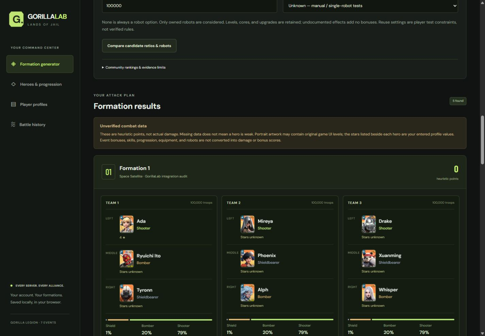
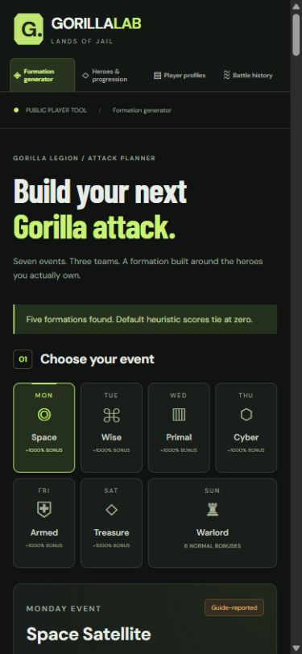

# GorillaLab browser integration audit

Date: 2026-10-24. URL: http://127.0.0.1:5173/ .
All application, test, documentation and screenshot changes are confined to
`D:\gorillalab\gorillalab-main`. Trial Cage Generator was not accessed or modified
in this audit. No deployment was performed.

## Browser and data scope

This audit used the live site in the Codex in-app browser, not jsdom alone.
The earlier localhost connection blocker did not recur. The user's existing
native Chrome profiles were not opened or edited.

The browser initially showed no saved profiles. Two clearly named test profiles
were created through the interface:

- `Audit control — untouched`: server 99002, season 2, no owned heroes or robots.
- `GorillaLab integration audit`: server 99001, season 6, nine deliberately
  selected owned heroes, Ada progression, and one manually owned Light Cone robot.

The chosen heroes were Tyronn, Phoenix, Xuanming, Ryuichi Ito, Whisper, Alph,
Ada, Drake and Mireya. Classes came from existing source-observed catalog data.
All entered progression and test damage are synthetic audit inputs, not claims
about a real player's account or real combat performance. Four manual synthetic
99001 records and the explicitly imported 11-record optional Server 260 dataset
were kept separate. No localStorage clear, profile overwrite, or profile deletion
was used. Existing unknown record dates were not retroactively filled.

## Live browser results

| Requirement | Browser evidence / outcome |
| --- | --- |
| Seven Gorilla selections | Selected all seven buttons; each selected state, title, guide ratio and category changed correctly. Sunday displayed six distinct normal-strength categories. |
| Create/select profile | Created and saved the two profiles, switched between them, and reloaded the live page. |
| Owned heroes | Selected nine checkboxes through catalog search; ownership persisted across reload. |
| Stars, skills and equipment | Ada's four entered stars, skill entry level 3, equipment level 2, exclusive equipment name/level, and season override 5–6 persisted after reload. These were synthetic profile entries. |
| Season filtering | At profile season 4, Ada disappeared from Owned & season-eligible and readiness changed from nine to eight; restored season 6. |
| Three valid teams | Live generator returned five formations; inspected the first result's rendered teams: exactly three heroes per team, one of each class, nine unique hero names overall. |
| Shared optimization | Compared five candidate plans, applied one, checked planned versus entered-count language, and generated real engine results through the UI. |
| Independent optimization | Adjusted a team's split, compared independent plans, and generated results. Retested after fixes on the mobile viewport. |
| Ratios versus baseline | Each plan now shows guide baseline and candidate ratios together, with scope, troop order and non-optimality labels. |
| Robot management | Added Light Cone ownership, level 10, a named core level 3, and upgrade level 4. Verified persistence and assigned the owned robot to Team 1. Generator options contained only Unassigned and the owned Light Cone. |
| Stale plan handling | After comparing plans, changed robot assignment; five old plans disappeared. Fresh comparison used the new context. |
| Optional community tiers | Generated once with tiers off (zero default points) and once with provisional tiers on (per-hero ordinal explanation). Labels explicitly separated opinion from combat effects and damage. |
| Scores and warnings | Expanded score explanations and inspected per-team points, per-hero tier points, bounded-search caveats, Ada's pending rule, and unverified-data warnings. |
| Formation-to-history handoff | Reproduced the old bug from Wise Formation 4. After fixing it, the history view opened with Wise, Formation 4, the matching server, Individual attack and snapshot attachment selected. |
| Battle entry/view | Saved manual test records with formation, counts, robot and progression snapshots. Expanded View record to inspect the exact team lineup and Ada/robot progression. |
| Native date entry | Reproduced a date input that displayed a value without committing it. After the input-event fix, the entered 2026-10-20 date persisted in a newly saved record. Earlier unknown dates stayed unknown. |
| Battle comparison | Selected two synthetic individual records; UI showed the observed difference of 10 and missing-date/confounding warnings, without a causal damage claim. |
| JSON export/import | Triggered an actual JSON download, then imported that exported file via the browser file chooser. Exact re-import did not duplicate records or remove later records. |
| CSV export/import | Triggered an actual CSV download, then imported it through the file chooser; records and snapshots were retained. Downloads used the browser's normal download folder. |
| Optional Stiletto 260 import | First attempted import on server 99001: rejected with no changes. Explicitly switched history scope to 260, chose the same project sample file again, and imported all 11 records. This also verified same-file retry after an error. |
| Aggregation guard | Compared the optional unknown-aggregation Primal record with the dated five-attack total: comparison blocked; no conversion into single-attack damage. |
| Other profile unchanged | Reopened the control profile after import: original name, server 99002, season 2, zero owned heroes, zero owned robots. Reopened the audit profile; its nine heroes and progression remained. |
| Browser errors | Final captured console warning/error list was empty. |

## Desktop and responsive layouts

All four main views were inspected at viewport widths 320, 390, 768 and 1440.
At 390/768/1440 there was no document-level horizontal overflow. At 320, the
Shared/Independent segmented control initially extended the generator document
from a 305px content width to 310px. Wrapped the panel heading at narrow widths;
the document then measured 305px/305px. Other 320px views already fitted.

Real viewport checks are not physical-device tests. Native Chrome's separate user
profile, Firefox, Safari, screen-reader behavior, and physical Android/iOS devices
were not independently exercised. The viewport override was reset afterward.

Screenshot evidence:

- [Desktop results](browser-audit/desktop-results.jpg)
- [Mobile generator](browser-audit/mobile-generator.jpg)
- [Mobile results](browser-audit/mobile-results.jpg)

## Fixes made

1. Carry selected formation index, event and server into Battle history; deliberate
   Log an attack handoff defaults to an individual attack with its exact snapshot.
2. Show each optimized candidate directly beside its selected-event guide baseline.
3. Hide previously evaluated optimizer output when profile, robot, catalog, event
   or scoring context changes, preventing application of stale recommendations.
4. Commit native date input events as well as change events; do not infer dates
   for records that were previously saved with unknown dates.
5. Expose full historical lineups, ratios, counts, robots, recorded progression
   and notes through View record rather than requiring a JSON export to inspect it.
6. Reset the file input after successful or failed import so users can retry the
   same file after switching to the proper server; use a connected download anchor.
7. Wrap the composition heading/mode control to remove the 320px horizontal overflow.

No combat mechanics, scoring weights, hero ownership defaults, troop multipliers,
or damage-prediction claims were introduced. No saved-data schema migration or
existing-record rewriting was necessary.

## Automated / code-only coverage

The original 100 tests are preserved. Three regression tests bring the suite to
103 tests across 13 files:

- Non-Space Formation 4 handoff saves the matching lineup/snapshot without changing
  saved player profiles.
- Optimizer candidate/baseline display and stale-result invalidation on context change.
- Native date input-event persistence and inspectable missing metadata.

The existing import regression also checks that the file input resets after an
error. The broader suite covers all seven event engines in both modes, class and
hero uniqueness, Ada's actual-count boundary, malformed/future imports, lossless
CSV/JSON, atomic cross-server isolation, optional-data unknowns, exact observation
matching, robot effect/ownership gates and deterministic large-catalog search.
Those exhaustive edge cases were automated code tests, not all repeated manually
in the live browser. No actual game battle, robot bonus, or damage formula was
verified by this website audit.

## Final verification and remaining limits

- `npm run build`: passed.
- `npm test`: 103 passed, 13 test files passed.
- `npm audit`: zero vulnerabilities, including zero critical vulnerabilities.
- Local Vite preview remains running at http://127.0.0.1:5173/ .
- No reproducible blocker remains for the audited in-app-browser UI flows.
- Physical-device / other-browser coverage remains outstanding.
- Unknown combat mechanics, provisional rankings, bounded-search limitations and
  portrait redistribution uncertainty remain as documented in the existing reports.

No deployment and no Trial Cage Generator changes were performed.
